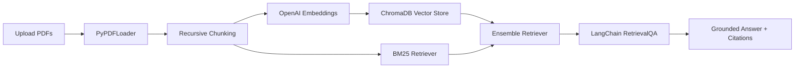

# 📚 DocuChat - Production-Leaning RAG Q&A

[](https://github.com/CLOVER-LOVES/DOCURAG/actions/workflows/ci.yml)
[](https://www.python.org/)
[](https://streamlit.io/)
[](LICENSE)

> Intelligent PDF question answering with hybrid retrieval, grounded citations, evaluation utilities, tests, and Docker deployment.

## ✨ Visual Overview



## 🚀 Features

| Area | Included |
|---|---|
| Retrieval | Dense Chroma search + optional BM25 hybrid retrieval |
| Advanced RAG | Optional cross-encoder reranking |
| Data support | Text-based PDFs, with optional OCR fallback |
| Answers | Source-grounded responses with document/page citations |
| UX | Framer Motion-inspired Streamlit interface |
| Ops | Lightweight query dashboard and JSONL logging |
| Quality | Pytest tests for chunking and metrics |
| Deployment | Dockerfile and GitHub Actions CI |

## 🖼️ Screenshot

Add a screenshot after launch:

```text
docs/screenshot.png
```

Recommended screenshot setup:
1. Run the app.
2. Upload a sample PDF.
3. Capture the UI with one answered question and visible source citations.
4. Save it as `docs/screenshot.png`.
5. Add this line under the screenshot section:

```markdown

```

## ⚡ Quick Start

```bash
git clone https://github.com/CLOVER-LOVES/DOCURAG.git
cd DOCURAG
python3 -m venv venv
source venv/bin/activate
pip install -r requirements.txt
```

Create `.env`:

```env
OPENAI_API_KEY=your_api_key_here
```

Run:

```bash
streamlit run app.py
```

Open:
```text
http://localhost:8501
```

## 🧪 Testing

```bash
python -m pytest -q
```

## 🐳 Docker

```bash
docker build -t docuchat .
docker run -p 8501:8501 --env-file .env docuchat
```

## 📊 Evaluation

```bash
python scripts/run_eval.py --dataset eval/qa_sample.json
```

Metrics include:
- Precision@k
- Recall@k
- MRR
- Answer keyword coverage
- Lexical faithfulness
- Retrieval/generation latency

## 🏗️ Architecture

```text
app.py
├── docurag/
│   ├── config.py
│   ├── ingestion.py
│   ├── retrieval.py
│   ├── reranking.py
│   ├── qa.py
│   ├── evaluation.py
│   └── monitoring.py
├── tests/
├── scripts/
├── eval/
├── Dockerfile
└── .github/workflows/ci.yml
```

## 🔧 Optional Advanced Dependencies

```bash
pip install -r requirements-optional.txt
```

Optional features:
- `sentence-transformers` for cross-encoder reranking
- `pytesseract` + `pdf2image` + Tesseract for OCR
- Poppler and Tesseract system binaries for scanned PDFs

## 🔐 Notes

- `.env` is ignored by Git. Rotate any API key that was ever shared.
- Scanned/image-only PDFs need OCR support enabled.
- OpenAI credits are required when using OpenAI embeddings and chat.
- Use **Clear Database** before reprocessing the same corpus to avoid duplicate chunks.

## 📄 License

This project is licensed under the MIT License. See [LICENSE](LICENSE) for details.
